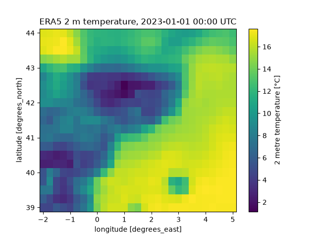

# mini-era5-pipeline


A small, fully tested pipeline that downloads ERA5 reanalysis data, runs automated data-quality checks, and packages it as an [Anemoi](https://anemoi.readthedocs.io/projects/datasets/en/latest/) dataset ready for ML training.

I built it as a learning project to practise the full chain around ML-ready NWP data: data access, quality assessment, automated testing, containers and CI/CD.



## What it does

1. **Downloads** ERA5 single-level data from the Copernicus Climate Data Store (CDS): 2 m temperature, 10 m wind components and total precipitation, over 44°N–39°N, 2°W–5°E, every 6 h for January 2023.
2. **Checks data quality** (`src/era5qc/quality.py`): missing variables, NaNs, physically implausible ranges, time-axis gaps and duplicates, grid regularity, unit metadata and ERA5 vs ERA5T versions.
3. **Tests the checks** (`tests/`): synthetic datasets are deliberately corrupted to prove each check actually catches its failure.
4. **Builds an Anemoi dataset** (`recipes/era5-mini.yaml`) from the NetCDF files and verifies it against the source data.
5. **Runs automatically**: tests and a Docker build on every push via GitHub Actions.

## Quality checks

| Check | Detects | Status on failure |
|---|---|---|
| `variables` | Requested variables missing | FAIL |
| `nan` | Missing values | FAIL |
| `rango` | Values outside physical limits (e.g. t2m outside 220–330 K, negative precipitation) | FAIL |
| `tiempo` | Missing, duplicated or unordered time steps | FAIL |
| `rejilla` | Irregular latitude/longitude spacing (expected 0.25°) | FAIL |
| `unidades` | Units metadata that differs from what ERA5 documents | WARN |
| `expver` | Mix of final ERA5 (`0001`) and preliminary ERA5T (`0005`) | WARN |

On the real January 2023 sample, all checks pass: 124 time steps, no NaNs, t2m between 256.9 K and 294.8 K, wind within ±18 m/s, maximum hourly precipitation of 3.7 mm.

## Project structure


## Quick start

Requires Linux (developed on Ubuntu under WSL2) and Python 3.11+.

```bash
git clone https://github.com/moratinosmorenoolga-12/mini-era5-pipeline.git
cd mini-era5-pipeline
python3 -m venv .venv && source .venv/bin/activate
pip install -e ".[dev]"
pytest -v
```

To download real data you need a free [CDS account](https://cds.climate.copernicus.eu), the ERA5 licence accepted, and your API key in `~/.cdsapirc`. Then:

```bash
python src/era5qc/download.py     # writes data/era5_sample.nc
```

Note: the CDS delivers a ZIP containing two NetCDF files (instantaneous and accumulated variables). Unzip it into `data/` before running the checks:

```bash
mv data/era5_sample.nc data/era5_sample.zip
unzip data/era5_sample.zip -d data
python -m era5qc.quality
```

## Docker

```bash
docker build -t era5qc .
docker run --rm era5qc
```

## Building the Anemoi dataset

Anemoi uses its own environment (Python 3.12):

```bash
uv venv --python 3.12 .venv-anemoi
source .venv-anemoi/bin/activate
uv pip install "anemoi-datasets[create]" netcdf4
anemoi-datasets create recipes/era5-mini.yaml data/era5-mini.zarr --overwrite
anemoi-datasets inspect data/era5-mini.zarr
```

Result: a Zarr dataset of shape 124 × 4 × 1 × 609 (time × variables × ensemble × grid cells; 609 = 21 × 29). I verified that every variable in the Zarr is numerically identical to the source NetCDF.

## Things I learned along the way

- The new CDS API can return a ZIP disguised with a `.nc` extension.
- Anemoi ignores the `expver` coordinate, so the ERA5/ERA5T check has to run *before* the dataset is built, otherwise that information is lost.
- With fewer than 10 years of data, Anemoi computes its statistics leaving out the last 20% of dates.
- Breaking a check on purpose and watching CI go red is the only way to know the safety net works.

## Limitations and next steps

- One month and one small region; scaling to years of data is the next step.
- Checks are per-variable; spatial and temporal consistency checks (sudden jumps, cross-variable plausibility) are not implemented yet.
- Dependency versions are not pinned.
